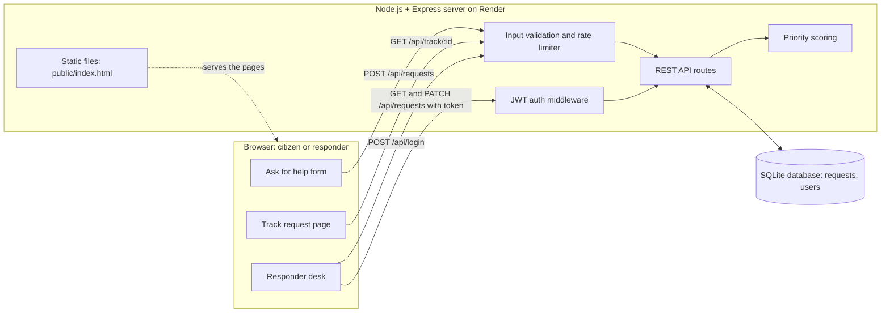

# ReliefDesk – System Architecture

## Components
| Layer | Technology | Role |
|---|---|---|
| Frontend | HTML, CSS, JavaScript | Request form, tracking page, responder dashboard |
| API | Node.js 22, Express | REST endpoints, validation, rate limiting |
| Security | JWT, bcrypt | Responder login and protected endpoints |
| Logic | JavaScript | Priority score from urgency, group size and vulnerable people |
| Database | SQLite (`node:sqlite`) | Stores requests and responder accounts |
| Hosting | Render | Runs the server and serves the app |

## Request flow
1. A citizen submits the form and the API validates it and saves it to SQLite.
2. The API returns a tracking ID such as `RD-4821`.
3. A responder signs in and receives a JWT. The dashboard lists requests sorted by priority score.
4. The responder assigns a team or changes the status, and the API updates the database.
5. The citizen's tracking page reads the same record and shows the new status.
