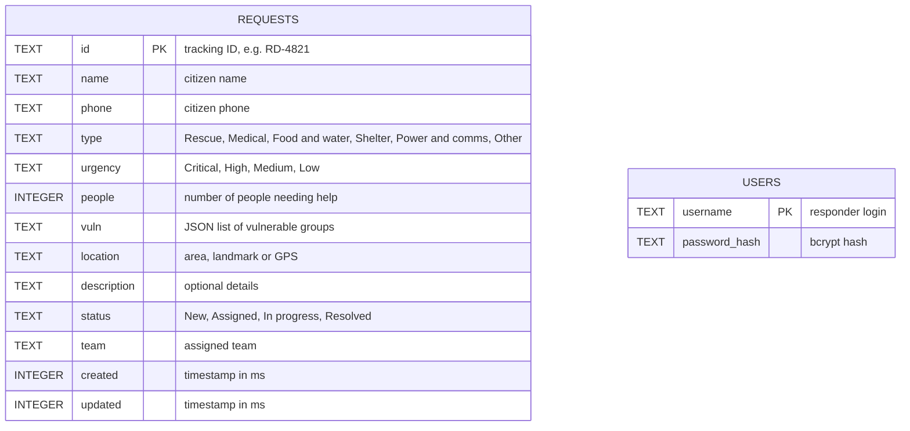

# ReliefDesk – Database Design (ER Diagram)

## Notes
- **requests** holds every help request. The priority score is calculated by the API from `urgency`, `people` and `vuln`, so it is not stored.
- **users** holds responder accounts. The first admin is created from the `ADMIN_USER` and `ADMIN_PASS` environment variables.
- The two tables are separate. Responders act on requests through the authenticated API, so there is no foreign key between them.
- Database: SQLite, using Node's built-in `node:sqlite` module.
